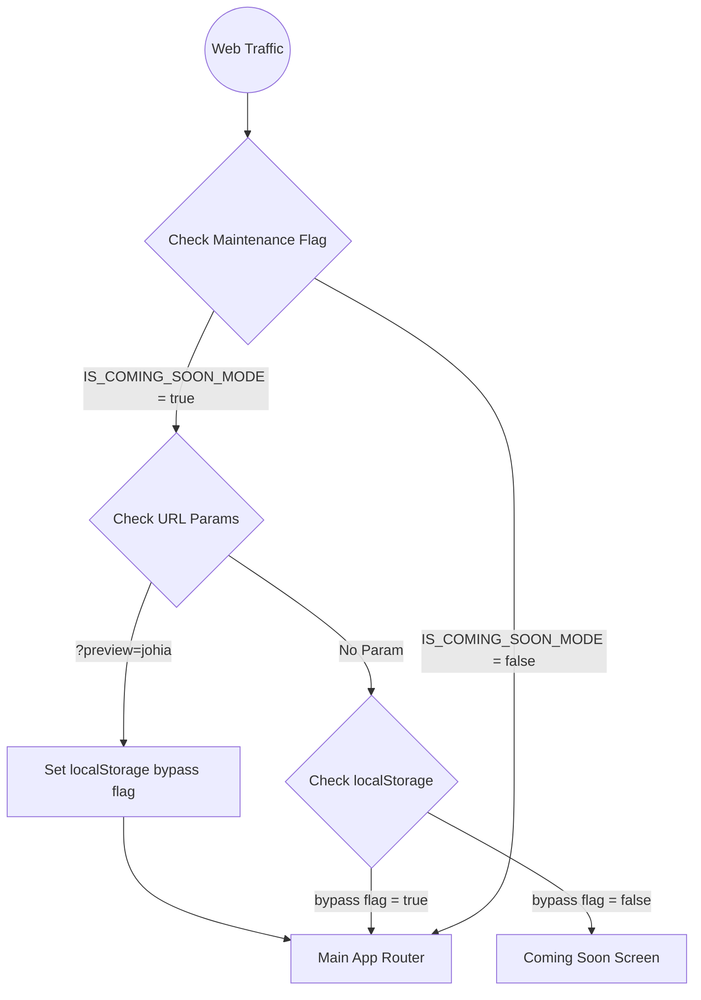
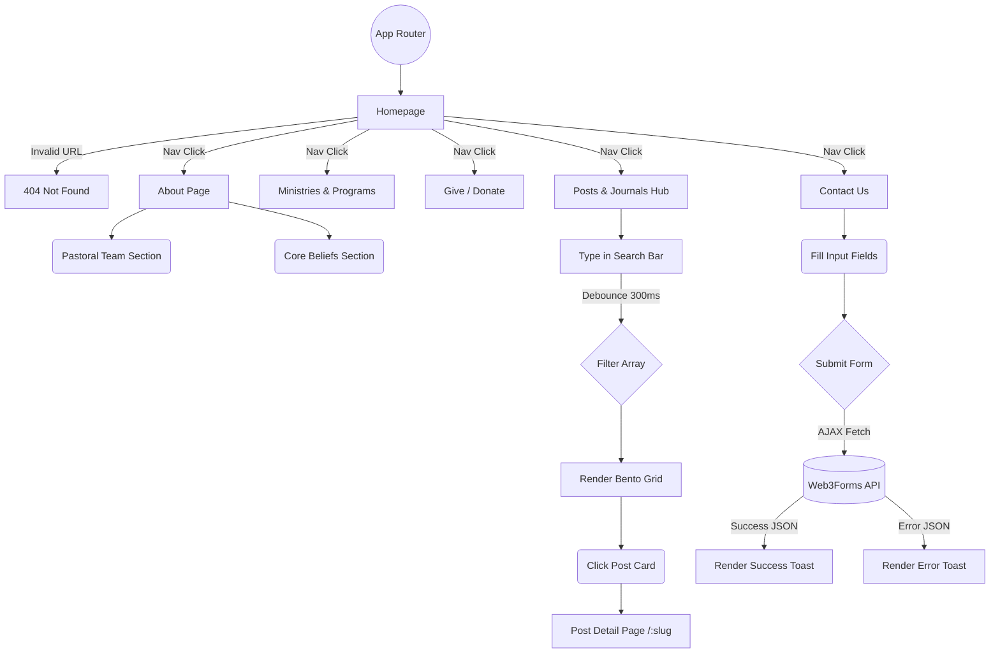

# App Flow Document

## 1. Overview
This document exhaustively maps the user journeys and technical routing paths through the JOHIA Cubao V2 website. It serves as a guide for understanding how state, authentication gates, and route transitions interact.

## 2. Core Routing Architecture & Gatekeeping

The application utilizes a strict top-level routing gate in `App.jsx` based on the `IS_COMING_SOON_MODE` global flag.

## 3. Main Application Flow

Once inside the `AppRouter`, all transitions are wrapped in `framer-motion`'s `<AnimatePresence>` to ensure smooth page-to-page fading. If a route is lazy-loaded, the `PageSkeleton` renders temporarily.

## 4. Key UX Journeys

### Journey 1: The Content Consumer (Sermons/FA)
1. User lands on **Homepage**.
2. Clicks "Journals" or "Posts" in the navigation.
3. Lands on the **Content Hub** (`/posts`).
4. User types "Youth" into the search bar.
5. The application waits 300ms (Debounce), then filters the posts to only show Friday Alive (FA) and youth-related sermons.
6. User clicks a specific card.
7. User reads the sermon on the **Post Detail** (`/posts/:slug`) page.

### Journey 2: The Donor
1. User lands on **Homepage**.
2. Clicks "Give" in the main navigation.
3. Lands on the **Give Page**.
4. Reviews the core giving philosophy.
5. Scans the official GCash QR code displayed on the screen using their mobile banking app.

### Journey 3: The Stakeholder Preview
1. Administrator sends the link `johiacubao.com/?preview=johia` to a Ministry Leader.
2. The Ministry Leader clicks the link on their mobile device.
3. The React app detects the URL parameter, saves `bypassComingSoon=true` to local storage, and strips the parameter from the URL cleanly.
4. The Ministry Leader can now browse the entire live site as if it were fully launched, while the general public still sees the "Coming Soon" page.
