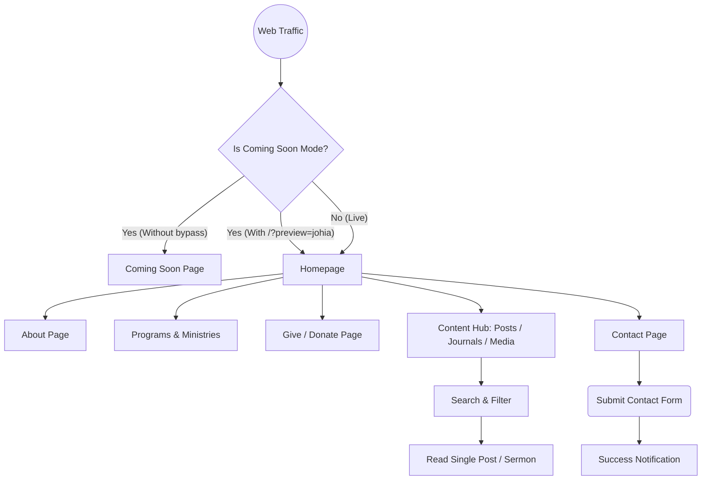

# App Flow Document

## 1. Overview
This document maps the main user journeys through the website, showing what happens when a user navigates between pages and interacts with core features.

## 2. Key User Journeys
* **New Visitor Journey:** Homepage -> About Page (to learn about the church) -> Ministries Page (to find a group).
* **Congregation Journey:** Homepage -> Posts/Journals (to read latest sermons or Friday Alive recaps).
* **Donation Journey:** Homepage -> Give Page -> Scan GCash QR or view bank details.

## 3. App Flow Diagram

## 4. Maintenance / Preview Flow
The application features a built-in maintenance gate (`IS_COMING_SOON_MODE`). 
1. User hits `johiacubao.com`.
2. App checks `localStorage` and URL parameters.
3. If no bypass is found, the user is locked into the `ComingSoon.jsx` route.
4. If `?preview=johia` is appended, a flag is stored in `localStorage`, and the full routing tree unlocks.
